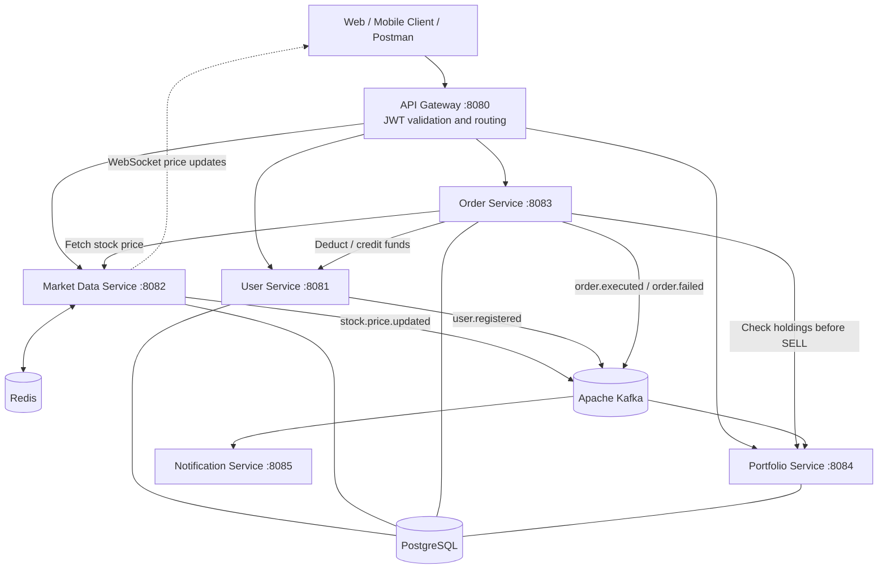

# Stock Trading App

A learning-oriented, microservices-based stock trading platform built with Java and Spring Boot. The project demonstrates API gateway routing, JWT authentication, stock-price streaming, order processing, wallet operations, portfolio tracking, caching, and asynchronous event-driven communication.

> **Project status:** Work in progress. Stock prices are simulated for development and demonstration; this is not connected to a real exchange and must not be used for actual trading or financial decisions.

## Table of Contents

- [Overview](#overview)
- [Architecture](#architecture)
- [Technology Stack](#technology-stack)
- [Services and Ports](#services-and-ports)
- [API Reference](#api-reference)
- [Internal Service APIs](#internal-service-apis)
- [Event-Driven Communication](#event-driven-communication)
- [Prerequisites](#prerequisites)
- [Local Setup](#local-setup)
- [Configuration and Secrets](#configuration-and-secrets)
- [Testing with Postman](#testing-with-postman)
- [Project Structure](#project-structure)
- [Current Limitations](#current-limitations)
- [Security Notes](#security-notes)
- [Contributing](#contributing)
- [License](#license)

## Overview

The application is organized as independently runnable services:

- **API Gateway** — single HTTP entry point, route forwarding, and JWT access-token validation.
- **User Service** — registration, login, user profile, wallet balance, and internal wallet operations.
- **Market Data Service** — stock catalog and prices, Redis caching, simulated price movements, WebSocket updates, and market-price events.
- **Order Service** — BUY/SELL order requests, market-price lookup, wallet operations, order persistence, and order events.
- **Portfolio Service** — user holdings, average purchase price, portfolio valuation, and asynchronous holding updates.
- **Notification Service** — consumes user/order events and currently writes notification messages to application logs.
- **AI Service** — a Python service directory is present, but an integrated API is not currently documented in this repository.

## Architecture



### Request flow

1. A client sends a request to the API Gateway on port `8080`.
2. For protected routes, the gateway validates the JWT access token.
3. The gateway removes any client-provided `X-User-Id` header and forwards the authenticated user ID as a trusted header.
4. The relevant service processes the request and owns its domain data.
5. Services use synchronous HTTP calls for operations that need an immediate response and Kafka events for asynchronous updates.

## Technology Stack

| Area | Technology |
|---|---|
| Language | Java |
| Backend framework | Spring Boot |
| API routing | Spring Cloud Gateway (WebFlux) |
| Authentication | JWT with JJWT; BCrypt password hashing |
| Service-to-service HTTP | Spring HTTP clients / configured service clients |
| Relational persistence | PostgreSQL, Spring Data JPA / Hibernate |
| Cache | Redis |
| Event broker | Apache Kafka (KRaft mode in Docker Compose) |
| Live price updates | WebSocket with STOMP/SockJS |
| Validation | Jakarta Bean Validation |
| Build | Maven |
| Containerized infrastructure | Docker Compose |
| AI service directory | Python; integration is not yet documented |

## Services and Ports

| Service | Port | Responsibility |
|---|---:|---|
| API Gateway | `8080` | Public entry point and JWT validation |
| User Service | `8081` | Registration, login, profile, wallet |
| Market Data Service | `8082` | Stock catalog, prices, Redis, WebSocket |
| Order Service | `8083` | BUY/SELL order processing |
| Portfolio Service | `8084` | Holdings and portfolio valuation |
| Notification Service | `8085` | Kafka event consumers; log-based notifications |
| PostgreSQL | `5432` | Relational databases |
| Redis | `6379` | Price cache |
| Kafka | `9092` | Event messaging |

The service configuration currently points to separate PostgreSQL databases named `user_db`, `market_db`, `order_db`, and `portfolio_db` on the local PostgreSQL server. Create these databases before starting the services, or update the JDBC configuration to match your environment.

## API Reference

Unless noted otherwise, use the API Gateway base URL:

```text
http://localhost:8080
```

Protected routes require:

```http
Authorization: Bearer <access-token>
```

The gateway validates the token and forwards the authenticated identity in `X-User-Id`. Do not send or trust a client-supplied `X-User-Id` value.

### User Service

| Method | Endpoint | Authentication | Description |
|---|---|---|---|
| `POST` | `/api/v1/users/register` | Public | Register a user |
| `POST` | `/api/v1/users/login` | Public | Authenticate and receive tokens |
| `GET` | `/api/v1/users/me` | Required | Get the current user's profile |
| `POST` | `/api/v1/users/me/funds/add?amount=5000` | Required | Add funds to the current user's wallet |

#### Register request

```json
{
  "email": "vansh.saini@example.com",
  "password": "ChangeMe123!",
  "firstName": "Vansh",
  "lastName": "Saini"
}
```

#### Login request

```json
{
  "email": "vansh.saini@example.com",
  "password": "ChangeMe123!"
}
```

### Market Data Service

| Method | Endpoint | Authentication | Description |
|---|---|---|---|
| `GET` | `/api/v1/market/stocks` | Required | Get stocks with current prices |
| `GET` | `/api/v1/market/stocks/{symbol}` | Required | Get the current price for one symbol |
| `GET` | `/api/v1/market/stocks/list` | Required | Get the stock catalog |

Example:

```http
GET http://localhost:8080/api/v1/market/stocks/AAPL
```

Prices are simulated in the Market Data Service and updated at the configured interval (currently 2 seconds).

### Order Service

| Method | Endpoint | Authentication | Description |
|---|---|---|---|
| `POST` | `/api/v1/orders` | Required | Place a BUY or SELL order |
| `GET` | `/api/v1/orders/my-orders` | Required | List the current user's orders |
| `GET` | `/api/v1/orders/{orderId}` | Required | Get one order, after ownership verification |

#### Place order request

```http
POST http://localhost:8080/api/v1/orders
```

```json
{
  "symbol": "AAPL",
  "type": "BUY",
  "quantity": 10
}
```

`type` accepts the enum values `BUY` and `SELL`. `quantity` must be at least `1`. The authenticated user ID is populated by the controller from the gateway-provided `X-User-Id` header; it should not be supplied by the client.

The order service fetches the current stock price and requests wallet/holding operations from other services. Order status and portfolio updates may be asynchronous.

### Portfolio Service

| Method | Endpoint | Authentication | Description |
|---|---|---|---|
| `GET` | `/api/v1/portfolio/me` | Required | Get the current user's holdings and portfolio valuation |

Example:

```http
GET http://localhost:8080/api/v1/portfolio/me
```

### WebSocket price stream

- Gateway WebSocket route: `ws://localhost:8080/ws/**`
- Market Data Service STOMP endpoint: `/ws` (SockJS enabled)
- Subscribe to: `/topic/prices/{symbol}` — for example, `/topic/prices/AAPL`
- Application destination prefix: `/app`

The service broadcasts simulated price updates to stock-specific topics. No `@MessageMapping` application destinations are currently documented.

### Actuator endpoints

The services expose the Actuator `health` and `info` endpoints where configured and enabled. Examples:

- `http://localhost:8080/actuator/health`
- `http://localhost:8081/actuator/health`
- `http://localhost:8082/actuator/health`
- `http://localhost:8083/actuator/health`
- `http://localhost:8084/actuator/health`
- `http://localhost:8085/actuator/health`

The gateway currently does not define proxy routes for the internal service APIs.

## Internal Service APIs

These APIs are intended for service-to-service communication. They are not routed through the public API Gateway. In a local development environment, callers use the service's direct address.

### User Service — wallet operations

Base URL: `http://localhost:8081`

| Method | Endpoint | Query parameter | Caller / purpose |
|---|---|---|---|
| `POST` | `/internal/users/{userId}/funds/deduct` | `amount` | Order Service deducts funds for a BUY |
| `POST` | `/internal/users/{userId}/funds/credit` | `amount` | Order Service credits funds for a SELL |

Example:

```http
POST http://localhost:8081/internal/users/user-123/funds/deduct?amount=2500.00
```

### Portfolio Service — holdings check

Base URL: `http://localhost:8084`

| Method | Endpoint | Purpose |
|---|---|---|
| `GET` | `/internal/portfolio/{userId}/holdings/{symbol}` | Return the user's share quantity for a symbol; returns zero when no holding exists |

Example:

```http
GET http://localhost:8084/internal/portfolio/user-123/holdings/AAPL
```

Example response:

```json
{
  "symbol": "AAPL",
  "quantity": 12
}
```

### Market Data Service — internal HTTP calls

The Order Service and Portfolio Service call the Market Data Service directly:

```http
GET http://localhost:8082/api/v1/market/stocks/{symbol}
```

This endpoint is also routed through the gateway for authenticated client access.

## Event-Driven Communication

Kafka is configured at `localhost:9092`.

| Topic | Producer | Consumers / purpose |
|---|---|---|
| `user.registered` | User Service | Notification Service logs a welcome message |
| `order.executed` | Order Service | Portfolio Service updates holdings; Notification Service logs an order notification |
| `order.failed` | Order Service | Notification Service logs the failure |
| `stock.price.updated` | Market Data Service | Publishes stock price updates; a consumer is not currently documented |

Notifications currently go to application logs; an email, SMS, or push-notification provider is not configured.

## Prerequisites

Install the following software:

- JDK compatible with the configured Spring Boot version (the project was developed using Java 25).
- Maven (or use each service's Maven Wrapper).
- Docker Desktop with Docker Compose.
- Git.
- Postman or another HTTP client (recommended).

Start Docker Desktop before running the infrastructure containers.

## Local Setup

### 1. Clone the repository

```bash
git clone https://github.com/VanshSaaini/Stock-Trading-App.git
cd Stock-Trading-App
```

### 2. Configure secrets and environment variables

Set environment variables before starting the services. Example PowerShell commands for the current terminal session:

```powershell
$env:POSTGRES_PASSWORD = "use-a-local-development-password"
$env:DB_PASSWORD = "use-a-local-development-password"
$env:JWT_SECRET = "replace-with-a-strong-base64-secret"
```

Generate a Base64-encoded secret containing at least 32 random bytes with OpenSSL:

```bash
openssl rand -base64 32
```

Use the same `JWT_SECRET` in the API Gateway and User Service. Do not commit actual secrets to Git. Check the YAML files for fallback development credentials and replace them before sharing or deploying this project.

### 3. Start infrastructure

From the repository root:

```bash
docker compose up -d
docker compose ps
```

The root Compose file starts PostgreSQL, Redis, and Kafka. It does **not** start the Spring Boot microservices automatically.

Check service logs if a container does not become healthy:

```bash
docker compose logs postgres
docker compose logs redis
docker compose logs kafka
```

### 4. Create application databases

The services are configured to use four databases on the PostgreSQL server:

```sql
CREATE DATABASE user_db;
CREATE DATABASE market_db;
CREATE DATABASE order_db;
CREATE DATABASE portfolio_db;
```

Run these statements as a PostgreSQL user with database-creation privileges. The Compose file initializes `trading_db`, which is separate from the four application database names.

### 5. Start each Spring Boot service

Open a separate terminal for each service and run `mvn spring-boot:run` from that service's directory.

```powershell
cd api-gateway
mvn spring-boot:run
```

Repeat for:

```text
user-service
market-data-service
order-service
portfolio-service
notification-service
```

Recommended startup order:

1. PostgreSQL, Redis, and Kafka
2. User Service
3. Market Data Service
4. Portfolio Service
5. Order Service
6. Notification Service
7. API Gateway

The order is a practical local-development sequence based on the services' dependencies, not a requirement for every component.

If Maven is not installed, use the Maven Wrapper provided in each Java service (`mvnw.cmd` on Windows).

### 6. Verify health

Where Actuator is enabled, check:

```http
GET http://localhost:8080/actuator/health
GET http://localhost:8081/actuator/health
GET http://localhost:8082/actuator/health
GET http://localhost:8083/actuator/health
GET http://localhost:8084/actuator/health
GET http://localhost:8085/actuator/health
```

### 7. Test the main flow

1. Register a user at `POST /api/v1/users/register`.
2. Log in at `POST /api/v1/users/login` and copy the access token from the response.
3. Add funds using `POST /api/v1/users/me/funds/add?amount=5000`.
4. Retrieve a stock price using `GET /api/v1/market/stocks/AAPL`.
5. Place a BUY order using `POST /api/v1/orders`.
6. Check order history using `GET /api/v1/orders/my-orders`.
7. Check holdings using `GET /api/v1/portfolio/me`.
8. For live updates, connect a STOMP/SockJS client to `/ws` and subscribe to `/topic/prices/AAPL`.

For protected calls through the gateway, set `Authorization: Bearer <access-token>`.

## Configuration and Secrets

Configuration files are located at:

- `api-gateway/src/main/resources/application.yaml`
- `user-service/src/main/resources/application.yaml`
- `market-data-service/src/main/resources/application.yaml`
- `order-service/src/main/resources/application.yaml`
- `portfolio-service/src/main/resources/application.yaml`
- `notification-service/src/main/resources/application.yaml`

Review these files before running the project. This repository currently uses local service URLs and database names. Update them when running services in containers, on another machine, or in a deployed environment.

## Project Structure

```text
Stock-Trading-App/
├── api-gateway/          # Routing and JWT filter
├── user-service/         # Authentication, users, wallet
├── market-data-service/  # Stock catalog, price cache, WebSocket
├── order-service/        # BUY/SELL orders and execution
├── portfolio-service/    # Holdings and valuation
├── notification-service/ # Kafka event consumers
├── ai-service/           # Python service directory (integration pending)
└── docker-compose.yml    # PostgreSQL, Redis, Kafka
```

Each Java service is a separate Maven project with its own `pom.xml`.

## Current Limitations

- Stock prices are simulated, not supplied by a brokerage or exchange.
- Notifications are logged, not delivered through email, SMS, or push services.
- The AI service directory is not currently documented as an integrated application service.
- Docker Compose starts infrastructure only; the Java services must be started separately.
- Internal APIs are not exposed by the gateway, but production deployments should additionally restrict network access and authenticate service-to-service requests.
- Order execution spans multiple services and is not a single distributed transaction. Kafka consumer failures can cause delayed or inconsistent portfolio updates; production use needs idempotency, retries, durable event processing, and reconciliation.
- This project is a development/learning implementation, not a production brokerage platform.

## Security Notes

- Never commit passwords, signing keys, API keys, or production credentials.
- Use strong secrets supplied through environment variables or a secret manager.
- Rotate any credential that has been committed or shared publicly.
- Keep internal wallet and holdings APIs private and protect service-to-service traffic.
- Use HTTPS/TLS, authorization policies, rate limiting, audit logging, and secure deployment configuration before any public deployment.
- Do not use simulated prices or this application to make real-money trading decisions.

## Contributing

Contributions, bug reports, and suggestions are welcome.

1. Fork the repository.
2. Create a feature branch: `git checkout -b feature/your-change`.
3. Make focused changes and run the relevant tests.
4. Commit your changes with a clear message.
5. Open a pull request describing the change and how it was tested.

## License

No license file was found in the project archive. Unless a license is added, standard copyright restrictions apply and reuse should not be assumed. Consider adding a `LICENSE` file if you want to permit open-source reuse.
